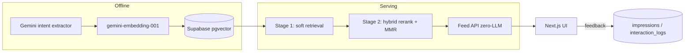

# Architecture

> Cập nhật Ngày 29 (v1.0) và mở rộng qua v2.0/v3.0. Sơ đồ Mermaid.js.

## TODO
- [ ] Sơ đồ tổng thể: Offline Pipeline → Supabase (pgvector) → FastAPI Zero-LLM Serving → Next.js.
- [ ] Luồng Hybrid Sandbox: SHA-256 → Semantic Cache → Gemini (Miss) → Graceful Degradation.
- [ ] Luồng Evaluation: Golden dev/test + Public Benchmark + Online Interleaving/OPE.
- [ ] Architecture Decision Records (ADR) cho các trade-off chính.

